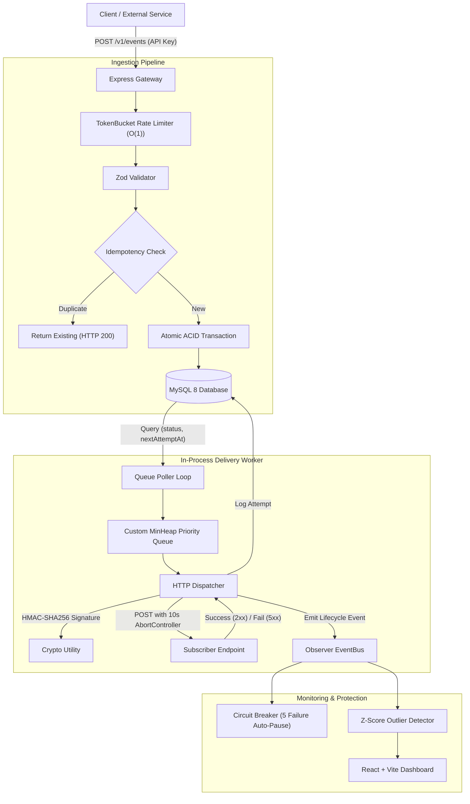

# HookRelay — Webhook Delivery Platform

*A durable webhook delivery engine with exponential retries, Token Bucket rate limiting, SSRF defense, and a real-time monitoring dashboard.*

[](https://github.com/your-username/HookRelay/actions/workflows/ci.yml)
[](LICENSE)
[](https://nodejs.org/)
[](https://www.mysql.com/)

---

## 1. What is HookRelay & Why I Built It

As a 3rd-year Computer Science & AI student, I built **HookRelay** as a capstone resume project to bridge university coursework concepts with real-world distributed systems engineering. 

When modern applications send webhooks (like Stripe processing payments or GitHub notifying CI servers), external subscriber endpoints frequently crash, experience network partitions, or suffer database deadlocks. If the sending system drops failed requests or hammers the recovering subscriber without backoff, data is lost and services crash again.

HookRelay solves this by acting as a **durable, rate-limited delivery relay**:
- Ingests events atomically with **idempotency deduplication**.
- Dispatches webhooks with **HMAC-SHA256 cryptographic signatures** and **10-second timeouts**.
- Implements **exponential backoff with Full Jitter** via a custom binary **Min-Heap priority queue**.
- Protects the engine using a custom **Token Bucket rate limiter** and **SSRF IP filter**.
- Automatically pauses crashing endpoints using a **Circuit Breaker** (5-failure threshold).
- Provides a **real-time React dashboard** featuring **Z-score statistical anomaly detection**.

---

## 2. University Course Alignment

| Course | Topic & Practical Implementation in HookRelay |
| :--- | :--- |
| **DSA & DAA** | Wrote my own array-backed binary **MinHeap** priority queue ($\mathcal{O}(\log N)$) to schedule retries, and my own **TokenBucket** class ($\mathcal{O}(1)$) with lazy timestamp refill. Analyzed backoff recurrence as a geometric series ($S_k = \text{base} \cdot (2^k - 1)$). |
| **DBMS** | Designed a normalized **3NF schema** in MySQL 8, enforced unique idempotency constraints, executed atomic event fan-out transactions, and documented **`EXPLAIN`** query plan speedups before and after adding composite index `(status, nextAttemptAt)`. |
| **Computer Networks** | Implemented **SSRF protection** by resolving DNS and blocking RFC 1918 private subnets and AWS metadata (`169.254.169.254`), **HMAC-SHA256 request signing**, **constant-time byte comparison**, **10-second AbortController timeouts**, and Wireshark inspection steps. |
| **System Design & SE** | Implemented the **Strategy Pattern** for backoff algorithms, the **Observer Pattern** (`eventBus`) for telemetry, a **Circuit Breaker** state machine, **Dead Letter Queue (DLQ)** replay, and 50 automated tests. |
| **Probability & Stats / ML** | Implemented percentile latency calculations ($P_{50}$ median, $P_{95}$ tail), success rate KPIs, and a statistical outlier detector using **Z-Scores** ($z = \frac{x - \mu}{\sigma} \ge 2.0$) with Bessel's correction to flag anomalous endpoints. |
| **Web App Programming** | Built a responsive **React 18 + Vite** dashboard with dark/light themes, Tailwind CSS, Recharts (area & donut charts), `useReducer` for table filters, and slide-over attempt timeline drawers. |

---

## 3. High-Level Architecture



---

## 4. Quick Start (Run in 2 Minutes)

### Prerequisites
- Node.js 20+ (ES Modules)
- MySQL 8.0 (or Docker Desktop)

### Option 1: Docker Compose (All-in-One)
```bash
# Clone the repository
git clone https://github.com/your-username/HookRelay.git
cd HookRelay

# Start MySQL, API, Mock Receiver, and Dashboard
docker compose up -d --build

# Run database synchronization and seed realistic data
docker compose exec api npx prisma db push
docker compose exec api npm run prisma:seed
```

### Option 2: Local Node.js Setup
```bash
# 1. Install dependencies
npm install
cd dashboard && npm install && npm run build && cd ..

# 2. Configure environment
cp .env.example .env

# 3. Synchronize database and seed data
npx prisma db push
npm run prisma:seed

# 4. Start the server (serves API + compiled dashboard)
npm start
```

Open your browser at **`http://localhost:4000/`**.

---

## 5. Live Interactive Demo (`npm run demo`)

I built a self-contained 2-minute demo script that walks evaluators through every feature:

```bash
npm run demo
```

**What the demo demonstrates live:**
1. **Developer Authentication** via JWT tokens.
2. **SSRF Defense** blocking attempts to reach `169.254.169.254`.
3. **Atomic Event Ingestion & Idempotency** (second identical request returns HTTP 200 with `duplicate: true`).
4. **TokenBucket Rate Limiter** bursting and throwing HTTP 429 with `Retry-After`.
5. **Worker HMAC Dispatch** with `X-HookRelay-Signature`.
6. **Circuit Breaker Auto-Pause** after 5 consecutive failures, followed by manual resume.
7. **Dead Letter Queue (DLQ)** isolation and instant re-queuing via `POST /v1/deliveries/:id/replay`.

---

## 6. cURL API Examples

### 1. Ingest an Event (with API Key)
```bash
curl -X POST http://localhost:4000/v1/events \
  -H "X-API-Key: hr_live_demo_key_9876543210abcdef" \
  -H "Content-Type: application/json" \
  -d '{
    "type": "payment.succeeded",
    "payload": {
      "orderId": "ord_1001",
      "amount": 4999,
      "currency": "USD"
    },
    "idempotencyKey": "idem_unique_key_001"
  }'
```

### 2. Register a Destination Endpoint
```bash
curl -X POST http://localhost:4000/api/v1/endpoints \
  -H "Authorization: Bearer <YOUR_JWT_TOKEN>" \
  -H "Content-Type: application/json" \
  -d '{
    "url": "http://localhost:4001/webhook",
    "description": "Order Notification Webhook",
    "eventTypes": ["order.*", "payment.succeeded"]
  }'
```

### 3. Replay a Dead-Letter Delivery
```bash
curl -X POST http://localhost:4000/v1/deliveries/<DELIVERY_ID>/replay \
  -H "Authorization: Bearer <YOUR_JWT_TOKEN>"
```

---

## 7. Dashboard Showcase

> *Screenshots from the React + Tailwind dashboard running at `http://localhost:4000/`:*

- **System Overview:** 4 animated KPI cards with sparklines, 24-hour deliveries area chart, status donut chart, and subscriber health table.
- **Deliveries Table & Slide-Over:** Filterable table with attempt count, clicking any row opens an attempt timeline drawer with HTTP headers, latency, and JSON payload.
- **Dead Letters (DLQ):** Lists permanently failed deliveries with one-click replay and live toast feedback.
- **API Keys Manager:** Generates hashed keys with masked prefixes and displays raw keys once.

---

## 8. Honest Engineering Trade-offs & Limitations

In my engineering decisions log ([docs/DECISIONS.md](docs/DECISIONS.md)), I documented deliberate trade-offs:

1. **MySQL 8 as Queue vs Redis / RabbitMQ:**
   - *Why:* Relational MySQL guarantees ACID durability without the operational complexity of managing two separate distributed stateful datastores.
   - *Limitation:* Polling MySQL tables limits single-worker throughput to ~500–1,000 deliveries/second. To scale horizontally across multiple worker nodes, we would adopt PostgreSQL with `FOR UPDATE SKIP LOCKED` or partition the queue with Apache Kafka.
2. **In-Memory Rate Limiting:**
   - *Why:* Storing token buckets in process memory enables sub-millisecond ($<0.1\text{ ms}$) rate check latency with zero network calls.
   - *Limitation:* Restarting the server resets bucket tokens. Running behind a multi-instance load balancer would require Redis for shared token state.
3. **In-Process Worker:**
   - *Why:* Keeps local setup zero-friction for evaluators running `npm start`.

---

## 9. Comprehensive Documentation Index

- [Architecture & UML Diagrams](docs/ARCHITECTURE.md)
- [DSA & Algorithms Notes (MinHeap, TokenBucket, Backoff Math)](docs/DSA_NOTES.md)
- [Database 3NF Rationale & EXPLAIN Query Plans](docs/DB_NOTES.md)
- [Database ER Diagram](docs/ER.md)
- [Networking, SSRF, HMAC & Wireshark Capture Guide](docs/NETWORKING.md)
- [Deployment Guide (AWS EC2 & Docker)](docs/DEPLOY.md)
- [Performance Benchmarks (Autocannon Results)](docs/BENCHMARKS.md)
- [Engineering Decisions Log](docs/DECISIONS.md)
- [20 Interview & Viva Questions & Answers](docs/INTERVIEW_QA.md)

---

## 10. License
MIT License. Built for learning and academic demonstration.
