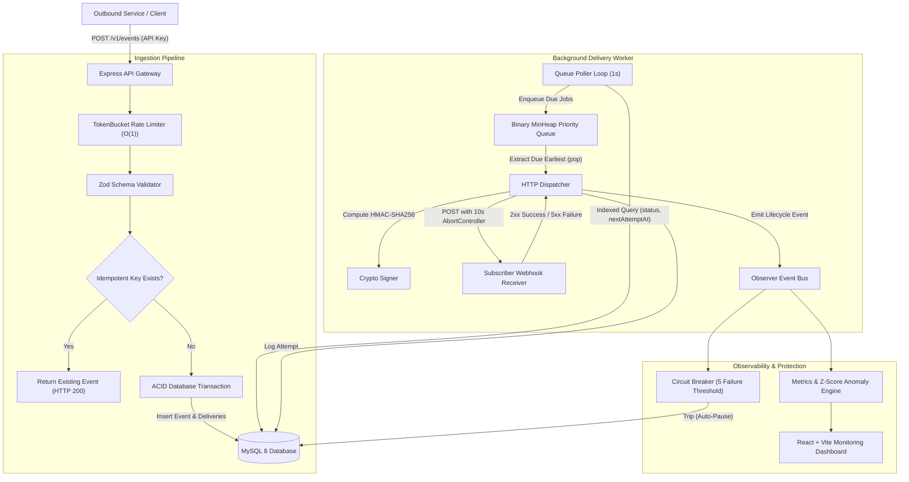
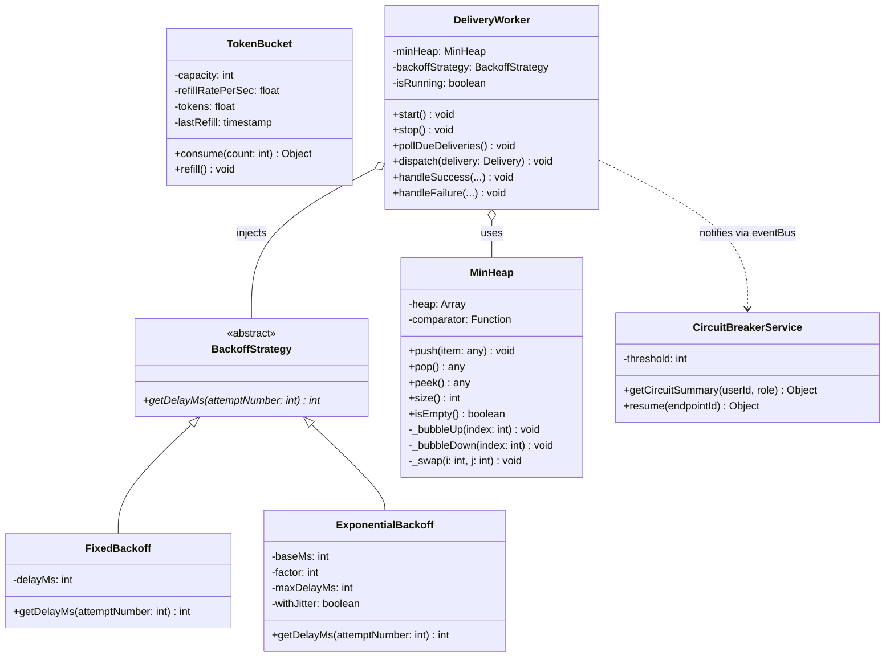
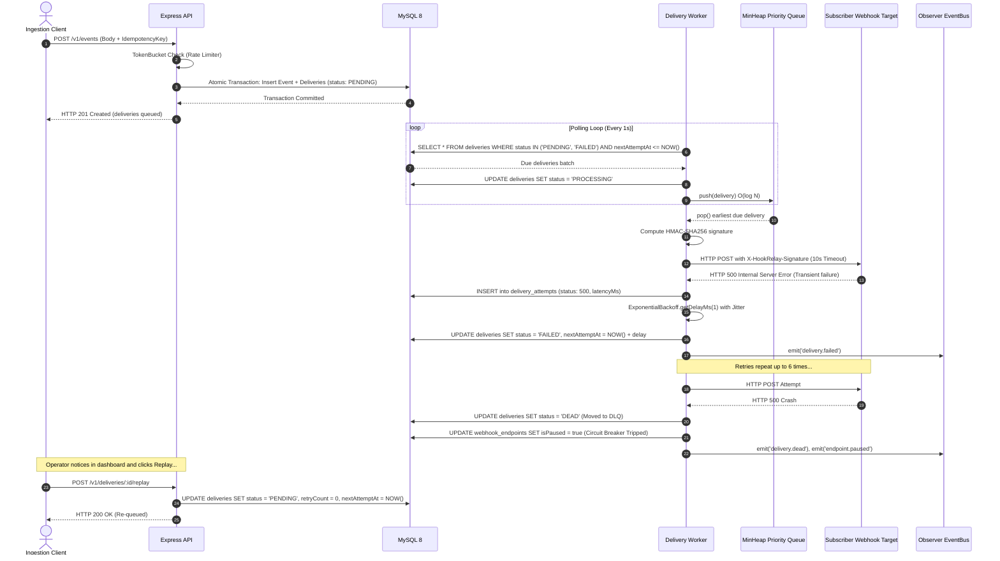

# System Architecture & Design Diagrams (HookRelay)

*Course Alignment: System Design & Software Engineering — Object-Oriented Architecture, Design Patterns, and Asynchronous Flow Control.*

---

## 1. High-Level System Architecture

HookRelay decouples event ingestion from external HTTP dispatching using a durable relational MySQL queue and an in-process worker backed by an in-memory priority queue (`MinHeap`).

---

## 2. UML Class Diagram (Design Patterns)

HookRelay applies established software engineering design patterns:
1. **Strategy Pattern:** `BackoffStrategy` with pluggable `ExponentialBackoff` and `FixedBackoff` implementations.
2. **Observer Pattern:** Node's `EventEmitter` decouples worker network dispatch from telemetry and circuit breaker updates.
3. **Data Access Object / Repository:** Prisma Client abstraction over normalized MySQL tables.

---

## 3. Webhook Delivery & Exponential Retry Sequence Diagram

This sequence diagram illustrates the lifecycle of an event triggering a delivery, encountering a transient failure, retrying with exponential backoff, tripping the circuit breaker, and executing a dead-letter replay:

