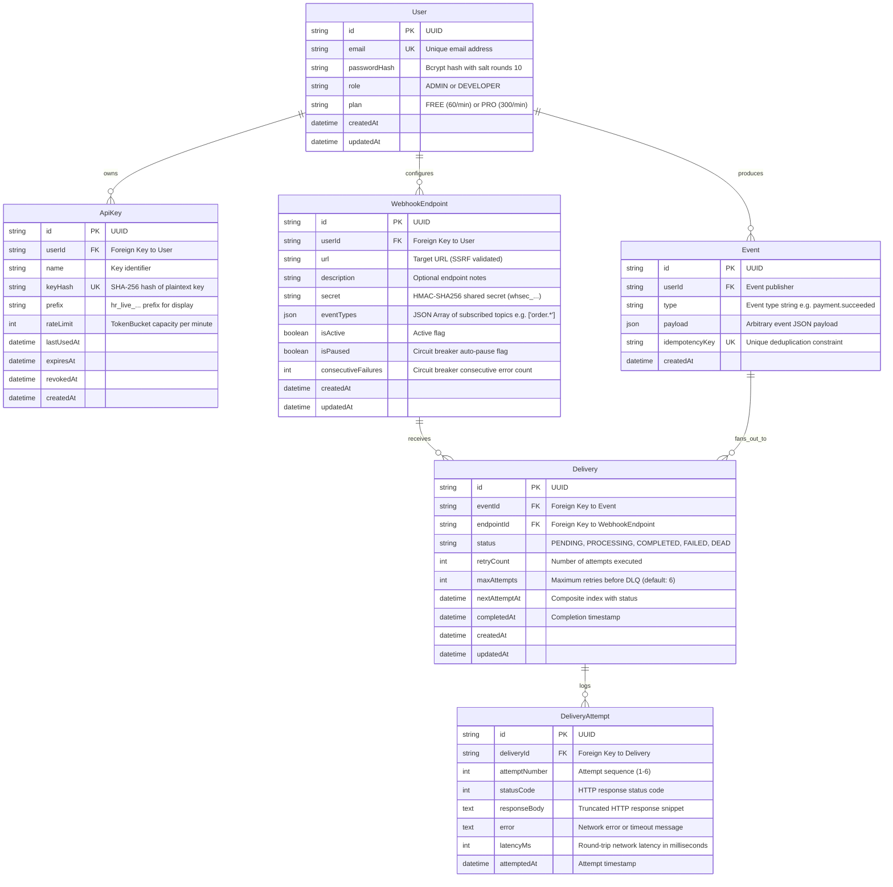

# Database Entity-Relationship (ER) Diagram

*Third Normal Form (3NF) relational schema for HookRelay.*

---

## Relational Constraints & Foreign Keys
1. **`User` $\to$ `ApiKey`:** `ON DELETE CASCADE`. When a user account is deleted, all their associated API keys are invalidated immediately.
2. **`User` $\to$ `WebhookEndpoint`:** `ON DELETE CASCADE`. Removing an account purges its registered endpoints.
3. **`Event` $\to$ `Delivery`:** `ON DELETE CASCADE`.
4. **`WebhookEndpoint` $\to$ `Delivery`:** `ON DELETE CASCADE`.
5. **`Delivery` $\to$ `DeliveryAttempt`:** `ON DELETE CASCADE`. An attempt cannot exist without its parent delivery job.

